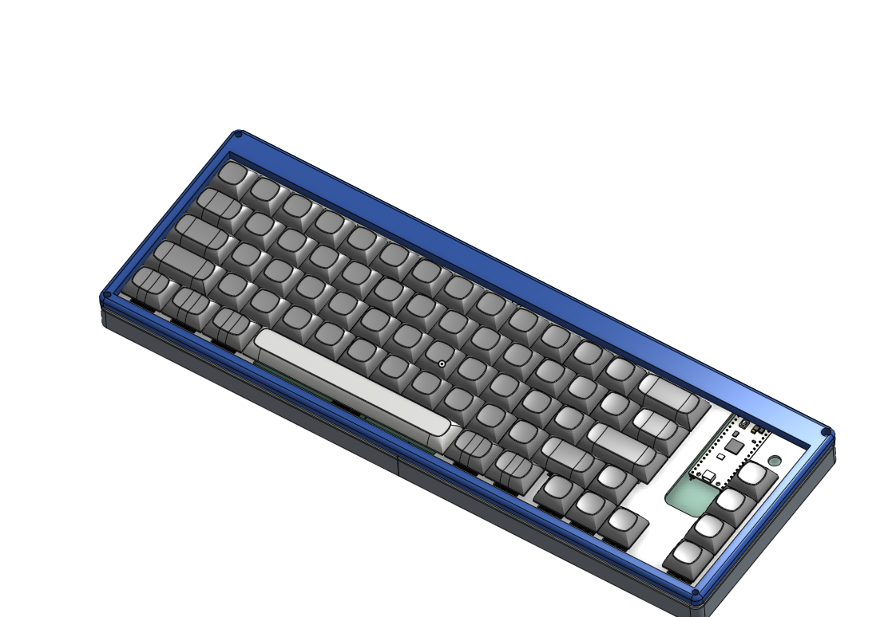

# Custom-Keyboard

Plan:

65% Keyboard

Rotary Encoder for Media Controls 

Foam Padding in the Case 

Result:

A nice-looking 65% keyboard that has a rotary encoder for media controls.

It took me a while to make because I ran into different problems along the way, but I managed to fix them eventually. I learned a bit of RMK and a bit more about PCB design, as I had previously made a MacroPad using QMK but had a few flaws, and so I was able to learn from my previous mistakes to make this project better. I built this because I was going to buy a keyboard for my laptop, but then I saw this competition and decided to do it myself.

https://cad.onshape.com/documents/b6e58a4c59b5eab8ab909f70/w/83c04b1bc76860f5f25fe353/e/ed9d0ab061e5040caacf7854

